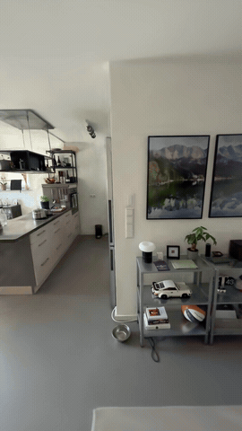

# iPhone Capture to Gaussian Interiors

**From handheld room capture to a 3D scene you can walk through.**

An end-to-end computer vision project spanning a native iPhone capture app, camera-pose refinement, and GPU-based Gaussian reconstruction. It supports both ARKit/LiDAR captures and ordinary video.

**[Watch the full 40-second walkthrough](docs/assets/reconstruction-walkthrough.mp4)** · [Source vs. reconstruction](#reconstruction) · [iPhone app](#iphone-capture-app) · [Results](docs/results.md)

The walkthrough is rendered from a trained Gaussian scene. Its camera follows the original capture route, with repeated scanning detours removed and motion smoothed.

## What I built

I built the capture app to get the exposure control missing from the apps I tried, then built the processing tools that connect phone recordings to reconstruction and extended training to test different geometry signals.

| Area | My work |
|---|---|
| **iPhone capture** | Native SwiftUI app using ARKit, AVFoundation and Metal; records RGB, poses, intrinsics and LiDAR, with a separate ultra-wide video/IMU mode. [App overview](docs/iphone-app.md) |
| **Data pipeline** | YAML-driven parsers for ARKit captures and video, frame extraction, camera-coordinate conversion, and COLMAP dataset export. [Pipeline](docs/pipeline.md) |
| **Camera alignment** | COLMAP pose-prior bundle adjustment and full SfM workflows, similarity alignment back to ARKit, and trajectory inspection. [Camera alignment](docs/pipeline.md#camera-alignment) |
| **Reconstruction experiments** | Integration with 3DGRUT, depth/SDF/normal loss extensions, and preprocessing for learned depth, surface normals and TSDF fusion. [Experiments](docs/results.md) |
| **Rendering and inspection** | Geometry comparison tools, checkpoint rendering, and smooth camera paths built from capture poses. [Camera-path design](docs/pipeline.md#walkthrough-camera-path) |

The renderer builds on **3DGRUT**; the capture tooling, preprocessing, integration and experimental extensions are the focus of this repository.

## iPhone capture app

**[LiDARCapture — app overview](docs/iphone-app.md)**

I built the app to control shutter speed and ISO while recording the camera data needed for reconstruction. It includes live tracking and motion-blur indicators, a coverage view, and capture export. ARKit mode records RGB, poses, intrinsics and LiDAR; a separate ultra-wide mode records video and IMU for the video/SfM route.

## Reconstruction

Source photographs beside rendered views from the C007 scene. The walkthrough uses a **2-million-Gaussian model trained for 50,000 steps**, with MCMC and PPISP.

| PSNR ↑ | SSIM ↑ | LPIPS ↓ |
|---:|---:|---:|
| 28.68 dB | 0.916 | 0.357 |

These are the run's saved evaluation metrics; evaluation was not rerun for the presentation. [Evaluation records](docs/results/evaluations.json) · [Rendering details](docs/figures.md)

## Lessons learned

These are practical findings from my captures and experiments.

- **Sharp frames mattered more than low ISO.** In my handheld captures, exposures longer than roughly **1/500 s** introduced motion blur that badly degraded reconstruction. Higher ISO noise was less damaging during training. This motivated the app's manual exposure controls.
- **Distortion support did not make iPhone ultra-wide capture a win.** I tested original distorted inputs, but the ultra-wide image quality in my captures limited the results. A renderer that handles fisheye cameras still needs good source images.
- **LiDAR helped with metric scale more than visual quality.** It provided a useful scale reference, but adding its geometry brought limited benefit to the final reconstruction in these experiments.
- **Blank walls leave depth underconstrained.** Featureless surfaces provide few reliable correspondences, so the standard image-based pipeline struggles to determine their geometry. I investigated monocular depth estimation and iPhone LiDAR as additional constraints; neither established a general solution in the tested runs.

[Pipeline diagrams](docs/pipeline.md) · [Comparisons and experiment tables](docs/results.md)

## About this repository

This is the public project showcase, with selected results and documentation. The capture app and full processing/training workflow are maintained privately while the implementation is prepared for release. Selected training extensions are visible in the [3DGRUT fork](https://github.com/soerenfi/3dgrut).

Compact input previews and depth comparisons are included for inspection. Full input images, raw capture videos, point clouds, model checkpoints and implementation files are not distributed here.

## Built with

Swift · Python · PyTorch · CUDA · ARKit · COLMAP

Reconstruction uses [3DGRUT](https://github.com/nv-tlabs/3dgrut), including MCMC and [PPISP](https://github.com/nv-tlabs/ppisp). Geometry experiments use [Depth Pro](https://github.com/apple-aiml-research/ml-depth-pro), [DSINE](https://github.com/baegwangbin/DSINE) and [Open3D](https://github.com/isl-org/Open3D). [Third-party notices](THIRD_PARTY_NOTICES.md) describe the methods used and the restrictions on optional research models.
