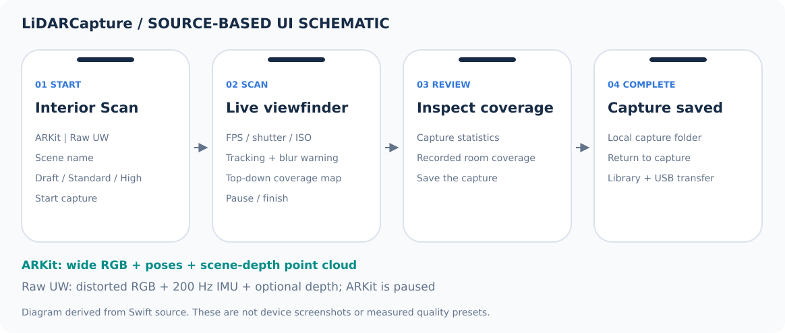

# LiDARCapture for iPhone

[Overview](../README.md) · [Reconstruction pipeline](pipeline.md)

A native SwiftUI capture app using ARKit, AVFoundation and a Metal preview.
It was built to control exposure while preserving the observations needed for
room reconstruction. The [LiDARCapture repository](https://github.com/soerenfi/LidarCapture)
is currently private; this showcase documents the app without distributing its
implementation.

This is a schematic based on the app source, not a device screenshot. Actual
device screenshots are not included.

## Capture modes

| | ARKit | Ultra-wide video |
|---|---|---|
| RGB | ARKit wide-camera feed | Original distorted ultra-wide frames |
| Poses | ARKit camera poses | Estimated later through SfM |
| Geometry | LiDAR observations | Optional depth when supported by the capture session |
| Motion | Used for live blur monitoring | Recorded IMU observations |
| Processing | ARKit preprocessing and pose refinement | Video/SfM route |

IMU and optional ultra-wide depth are retained observations; automatic fusion
into the desktop reconstruction was not implemented.

## Capture controls

The interface exposes shutter speed, ISO, tracking state, motion-blur feedback,
coverage and available storage. In these handheld experiments, exposure around
1/500 s or shorter helped preserve sharpness. Higher ISO noise was less damaging
than motion blur during reconstruction. This is a practical finding for the
capture conditions, rather than a universal shutter threshold.

## Reliability work

- Streamed LiDAR points to disk after an out-of-memory failure.
- Added bitrate presets and free-space feedback to manage recording size.
- Added movie fragmentation and recording-finalization safeguards.
- Refined session start/stop behavior and capture-library file indicators.

The app exports observations for desktop processing. Raw captures, device
identifiers, signing settings and implementation files are not included here.
The app was not rebuilt or retested on a device for this presentation update.
