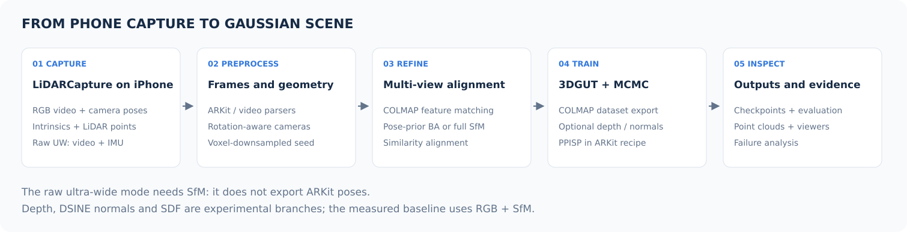
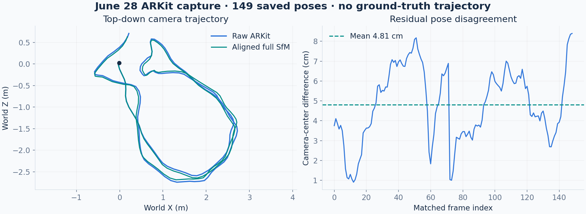
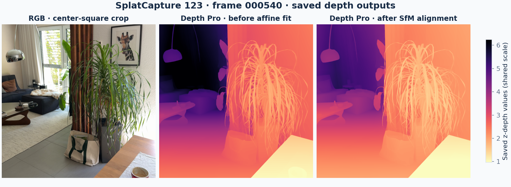
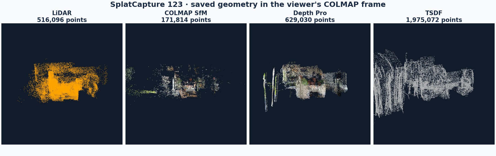

# From phone capture to reconstruction

[Overview](../README.md) · [Results](results.md) · [Capture app](iphone-app.md)

The work spans capture, consistent camera/image preprocessing, pose refinement,
geometry experiments and rendering. The full implementation is currently private;
this page describes the engineering decisions and available results.

## Capture

The native iPhone app records RGB, intrinsics, poses and LiDAR in ARKit mode.
A separate ultra-wide mode records video and IMU; ARKit is paused in that mode,
so camera poses are estimated through structure from motion.

Manual exposure control was the reason for building a capture app. In these
handheld experiments, exposures longer than roughly 1/500 s introduced motion
blur that substantially hurt reconstruction. Higher ISO was the more useful
tradeoff. The app also includes tracking, blur and coverage feedback.

## Camera alignment

Images, intrinsics, lens models and camera poses need to describe the same rays.
Image rotation changes both intrinsics and camera orientation. Camera-axis
conversion and world-frame rotation are handled separately. Ultra-wide trials
compared undistorted inputs with original distorted frames and a matching camera
model.

The ARKit route supports COLMAP bundle adjustment with position priors and a
full-SfM alternative. A similarity transform aligns reconstructed camera centers
back to the ARKit trajectory. Metric interpretation depends on that reference
and alignment; it is not ground-truth localization.

The June 28 artifact contains 149 matched poses. Their camera-center disagreement
is 4.81 cm mean, 7.54 cm p95 and 8.39 cm maximum. These values compare saved
trajectories; they do not measure error against a reference trajectory.

## Geometry experiments

LiDAR, SfM points, learned monocular depth and TSDF fusion provide different
sources of geometry. Blank surfaces remain difficult: weak visual correspondence
leaves depth underconstrained, while auxiliary observations introduce their own
noise, alignment and coverage limitations.

The RGB is a compact preview. Depth panels show predictions before and after
per-frame affine fitting to SfM anchors, with a common display scale. They are
not reference depth measurements. Depth Pro is a research-model dependency;
see the [model notices](../THIRD_PARTY_NOTICES.md#research-models).

These are rasterized inspection views with common bounds and deterministic
sampling. Point counts describe stored vertices, not independent measurements
or Gaussian counts. The underlying point clouds and source captures are not
included.

## Gaussian reconstruction

Training builds on NVIDIA's 3DGRUT implementation. Experiments include MCMC
training, PPISP appearance correction, and depth/SDF/normal regularization.
The project focuses on the capture tooling, camera consistency, integration and
experimental evaluation around those methods.

The selected C007 model uses 2 million Gaussians at 50,000 steps. Its saved
configuration disables depth, SDF, DSINE and planar losses. Training-time seed
hashes were not retained, so the complete initialization lineage cannot be
reconstructed from the saved configuration alone. See the [results](results.md).

## Walkthrough camera path

The forty-second tour uses selected poses along the original capture route.
Repeated scanning detours are removed, positions and viewing directions are
smoothed, and timing balances camera travel and turning with gentle starts and
stops. The final path was inspected to avoid cutting through furniture.

The MP4 contains 1,200 frames at 30 fps and 810 × 1440 resolution. The small GIF
is a twelve-second excerpt at 8 fps. These are actual scene-model renders;
the capture videos, full input images, checkpoints and camera-path arrays remain
private.
