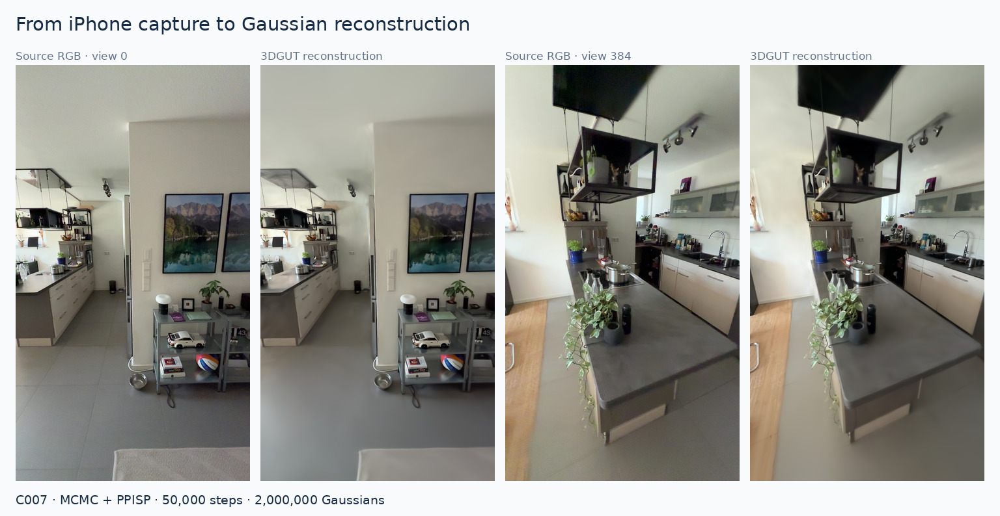
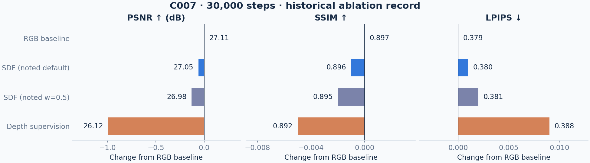

# Results and experiments

[Overview](../README.md) · [Pipeline](pipeline.md) · [Figure details](figures.md)

## Selected reconstruction

The selected demonstration is the C007 MCMC + PPISP scene at 50,000 steps and
2 million Gaussians. [Watch the full rendered walkthrough](assets/reconstruction-walkthrough.mp4).
The source panels are reduced previews, not distributed full-resolution inputs.

## Retained evaluations

| Run | Steps | PSNR ↑ | SSIM ↑ | LPIPS ↓ |
|---|---:|---:|---:|---:|
| C007 MCMC + PPISP | 50,000 | 28.68 dB | 0.916 | 0.357 |
| June 28 ARKit MCMC + PPISP | 30,000 | 26.16 dB | 0.878 | 0.318 |
| June 28 pose-prior BA + PPISP | 15,000 | 25.48 dB | 0.869 | 0.341 |
| June 28 full SfM + PPISP | 30,000 | 24.04 dB | 0.863 | 0.326 |

Values come from saved evaluation records; evaluation was not rerun for this
showcase. Captures, configurations, splits and training schedules differ, so
these rows are not a controlled ablation. The [compact evaluation record](results/evaluations.json)
retains the measured values without distributing inputs, checkpoints or local
filesystem paths.

## Historical C007 ablation

| Variant | Steps | PSNR ↑ | SSIM ↑ | LPIPS ↓ |
|---|---:|---:|---:|---:|
| RGB baseline | 30,000 | 27.11 dB | 0.897 | 0.379 |
| SDF, noted default weight | 30,000 | 27.05 dB | 0.896 | 0.380 |
| SDF, noted weight 0.5 | 30,000 | 26.98 dB | 0.895 | 0.381 |
| Depth supervision | 30,000 | 26.12 dB | 0.892 | 0.388 |

These values were transcribed from experiment notes and are retained as a
[CSV](results/c007_ablation.csv). Original baseline checkpoints, metric files,
exact resolved configurations and held-out indices were not recovered. Variance
across seeds is unknown. Small SDF differences do not establish significance.
The later C007 50k walkthrough uses a different configuration and schedule.

## What the experiments established

Camera/image consistency and sharp capture frames were recurring practical
requirements. LiDAR was useful as a metric reference but brought limited visual
benefit in the tested scenes. Featureless surfaces motivated learned-depth and
sensor-depth experiments; those observations did not establish a general
solution. The tested historical depth/SDF losses did not improve image metrics.

Later depth alignment, TSDF and normal-loss branches are engineering experiments.
Their existence is not evidence of a measured reconstruction-quality improvement.
The figures show inspectable results, with their limits described alongside them.
